<div align="center">

<picture>
  
</picture>


[](https://sandivd.github.io/downline/)

A small local app for Windows and Linux. Download videos from YouTube, Pornhub, Instagram, TikTok, X (Twitter), and Twitch. Flat surfaces, precise spacing, warm light mode, and charcoal dark mode. Built with a Python standard-library backend and an HTML/CSS/JavaScript interface. Downloads are performed by yt-dlp.

</div>

## Open the app on Windows

1. Extract **the entire ZIP** to a normal folder, such as `Documents\Downline`. Do not run it from inside the ZIP.
2. Double-click **Start Downline.cmd**.
3. On the first launch, leave the setup window open while it downloads the required tools. Allow several minutes and roughly 300–500 MB of free space. An internet connection is required.
4. The app opens in your default web browser. No particular browser is required; Windows uses your default HTTP browser association.

You do not need to install Python, Node, FFmpeg, or enter terminal commands. Setup uses the Windows built-in PowerShell and writes its runtime beside the app. It needs no administrator access and does not change your system PATH. Requires 64-bit Windows 10 or 11; x64 binaries are used.

If you already installed an earlier Downline version, quit Downline with its power button and copy the updated app files into your existing Downline folder, choosing Replace. Keep your existing `runtime` folder so the tools do not need to download again.

Downline always uses your system default web browser. Older saved browser preferences are ignored. To change the browser, update the default web browser in Windows Settings.

## Open the app on Linux

Download **Downline-Linux.tar.gz** from the website and extract the entire archive. The Linux package supports **x86-64 and ARM64 desktop distributions with glibc 2.35+**, including Ubuntu 22.04 and newer. Alpine/musl, 32-bit Linux and macOS are not supported by this launcher.

1. Install **Python 3.10+**, **FFmpeg** (including `ffprobe`), and **xdg-utils**, using your distribution's package manager. On Ubuntu / Debian:

   ```sh
   sudo apt update
   sudo apt install python3 ffmpeg xdg-utils
   ```

2. Open a terminal in the extracted `Downline` folder and run:

   ```sh
   bash start-downline.sh
   ```

3. On first launch, setup downloads official yt-dlp and Deno executables for your architecture, checks their SHA-256 values, and stores them in `runtime/tools`. It uses your system FFmpeg through local symlinks. No pip installation is needed and the launcher itself needs no administrator access.
4. Downline opens in your default browser. Keep the terminal open while using it. Use the sidebar power button to quit, then close the terminal.

The Linux archive preserves execute permissions, so `./start-downline.sh` also works. Launching scripts by double-click depends on your file manager; the terminal command works consistently. In Settings, enter full Linux folder/file paths, such as `/home/yourname/Downloads/Downline`; the native Browse dialog is Windows-only. The file manager must support `xdg-open` to open completed files and folders.

Settings and history are stored in `~/.local/share/Downline`, unless overridden with `DOWNLINE_DATA_DIR`. Downloads default to `~/Downloads/Downline`. Keep `runtime` when replacing app files. To install/check the tools without opening Downline, run `bash start-downline.sh --setup-only`. To run without opening a browser, use `--no-browser` and open the printed local URL yourself.

The initial Linux tool versions are pinned to yt-dlp **2026.10.26** and Deno **2.9.8**, using the SHA-256 digests published with those exact official release assets. **Settings → Check for updates** updates the local yt-dlp executable. Linux system packages remain managed by your package manager. The archive contains source and launchers, not preinstalled runtimes; the first setup needs access to GitHub releases.

## Download a video

- Paste a video URL from any of the six supported platforms. You can paste up to 50 URLs, one per line.
- **Get video details** looks up the title, creator, duration, and available resolutions for one link. This step is optional.
- Choose MP4, MKV, or MP3 and a quality ceiling. Then click **Add to download queue**.
- Files save to `Downloads\Downline` by default. Change the folder in **Settings**.
- In **History**, use the play button to open a downloaded file or the folder button to reveal it.
- Use the sun/moon switch at the bottom of the sidebar to change theme. Your choice is remembered.
- `Ctrl + Enter` adds the links to the queue.

**MP4** prefers H.264 video and AAC audio for broad compatibility. It may choose a lower resolution when higher-resolution streams only offer other codecs. Its fallback can retain other MP4-compatible codecs. **MKV** preserves the best available source codecs and is a good choice for 4K. **MP3** extracts audio; the video quality selector is disabled.

Quality is a ceiling when the site reports stream heights: the original video determines available resolutions. If the host omits resolution metadata, Downline uses an available stream. Downline handles individual video posts, Shorts, Reels, clips, and past broadcasts. Whole profiles, playlists, photo-only posts, and active live broadcasts are not supported. A post with multiple videos saves its first video; an explicit X `/video/2` link selects that video instead. Video details show source resolutions; a particular MP4 codec may not exist at every resolution.

## Supported links

| Platform | Paste a link to |
| --- | --- |
| YouTube | A video or Short, including youtu.be share links |
| Instagram | A Reel or video post, including supported share links |
| TikTok | An individual video, including vm.tiktok.com, vt.tiktok.com, and /t/ share links |
| X / Twitter | A video post on x.com or twitter.com; optional /video/1, /video/2, etc. |
| Twitch | A clip or past broadcast (/videos/…) |
| Pornhub | An individual video with a viewkey |

Mix platforms in the same batch. Each queue and history entry shows its source. Short share links are resolved by the download engine. Some sites require your own signed-in cookies in **Settings → Privacy → Cookies file**. The available media still depends on the source site and your account access.

## Queue and history

Settings allow 1–3 simultaneous downloads. **Pause queue** stops waiting videos from starting; current transfers continue. Cancel stops the selected download, including its processing tools. Retry continues partial downloads where the site and protocol support it. A cancelled or interrupted video is never automatically restarted.

Download history and settings live in `%LOCALAPPDATA%\Downline` on Windows and `~/.local/share/Downline` on Linux. Nothing is sent to an app account or analytics service. The download engine contacts the video sites and their media servers. No remote thumbnail images or fonts are loaded by the interface. Clearing history removes entries, not video files. Turning history off stops entries from being saved between sessions; entries remain visible during the current session.

Partial files are retained in a `.downline-partials` folder inside the chosen destination. They can be removed manually after a cancelled download is no longer needed. Retrying uses that same partial workspace. Completed jobs use unique filename suffixes to avoid collisions between different format or quality downloads.

The power button at the bottom of the sidebar quits the local service. Closing just the app window leaves the service running so downloads can finish. Reopening the launcher reconnects to that service. Download details are stored locally and are not encrypted.

## When a download fails

The actual site error appears on the download entry. Use **Settings → Check for updates** after finishing or cancelling your queue. Site changes can require a newer yt-dlp release. The app does not bypass unavailable videos, account restrictions, paywalls, DRM, or regional blocks. Some requests, especially Instagram and restricted social posts, may require sign-in or additional site-specific credentials; the included runtime does not guarantee that every video can be fetched.

If a video requires your own signed-in session, optionally select a Netscape-format `cookies.txt` file in Settings. Downline uses a temporary local copy and never modifies your original export. Cookies are sensitive account data. They are never included in this app ZIP or automatically collected from a browser. Cookie copies are deleted when operations finish; after a system crash, delete any leftover `cookies.txt` under `.downline-partials` or the system temp folder. Cookies cannot override restrictions your account cannot access.

If setup fails, its window stays open with the error. Check that your network allows `python.org`, `github.com`, and GitHub release downloads, then run the launcher again. Startup errors are recorded at `%LOCALAPPDATA%\Downline\startup.log`. The initial runtime downloads come from the projects linked below.

## Source and development

The source code is included. The app backend has no third-party Python dependencies. For an alternative source installation, install yt-dlp with its default dependencies, FFmpeg, and a supported JavaScript runtime, then run:

```sh
python3 app.py
```

For a development server without opening a browser:

```sh
python3 app.py --no-browser
```

Open the URL printed by the server, including its session fragment. The service binds only to `127.0.0.1` on a dynamically chosen port. Local API requests require a random session token and matching host/origin. Arbitrary server files are never served. Use `DOWNLINE_DATA_DIR` to isolate development data. Tests use pytest; the optional browser checks use Playwright. Neither is required to run the app.

## Components and licences

- App code: MIT; see `LICENSE`.
- Platform logos: bundled SVGs from Simple Icons and Wikimedia Commons; source and licence details are in `LOGO-SOURCES.md`.
- [yt-dlp](https://github.com/yt-dlp/yt-dlp): Unlicense source; standalone executable includes third-party licence notices. See its [licensing section](https://github.com/yt-dlp/yt-dlp#license).
- [yt-dlp FFmpeg builds](https://github.com/yt-dlp/FFmpeg-Builds): the downloaded build is GPL; see its bundled notices and upstream source/build recipes. No FFmpeg binaries are redistributed in this ZIP.
- [Deno](https://github.com/denoland/deno): MIT and third-party notices.
- [Python](https://www.python.org/downloads/release/python-31317/): Python Software Foundation licence; the runtime archive includes its licence.

The Windows launcher downloads all four tools on first launch. The Linux launcher downloads yt-dlp and Deno and uses your system Python and FFmpeg. No tool binaries are bundled in these source packages. YouTube support includes the official yt-dlp executable's EJS component and a Deno runtime, as described in the [yt-dlp EJS setup guide](https://github.com/yt-dlp/yt-dlp/wiki/EJS).


